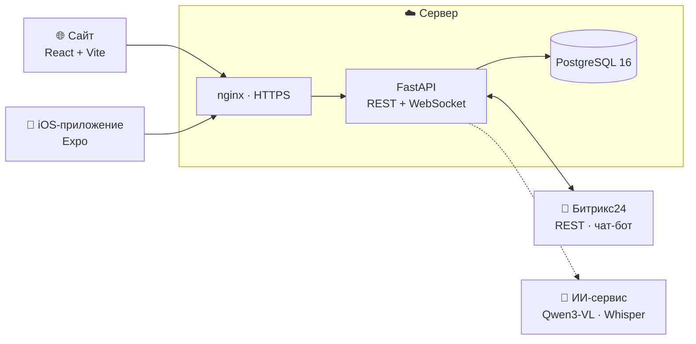
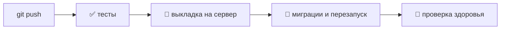

  

**Идея сотрудника не должна теряться в чатах.** 
Сотрудник пишет о проблеме или предлагает улучшение. Обращение само уходит ответственному, 
а автор видит, кто его рассматривает, что происходит сейчас и чем всё закончилось.

 

**[🌐 Открыть демо](https://modus-trade.makquiz.site)** &nbsp;·&nbsp; **[📦 Код проекта](https://github.com/Modus-trade/modus)** &nbsp;·&nbsp; **[📖 Документация](https://github.com/Modus-trade/modus/tree/main/docs)**

 

## 💡 Зачем это нужно

В компании идеи и жалобы обычно идут через мессенджеры, устные разговоры и почту. В итоге:

- непонятно, **кто отвечает** за вопрос;
- автор **не знает**, рассмотрели ли его обращение;
- одну и ту же проблему поднимают **снова и снова**;
- у руководства нет **общей картины**: что болит и где застревает.

**Модус** собирает всё в одном месте. У каждого обращения есть ответственный, срок первого ответа, история изменений и обязательный итоговый результат.

 

## 🚀 Попробовать за 3 минуты

Откройте **[modus-trade.makquiz.site](https://modus-trade.makquiz.site)**. Пароль для всех аккаунтов: `demo1234`.

| | Роль | Логин | Что увидит |
| :---: | --- | --- | --- |
| 👤 | Сотрудник | `employee@modus.demo` | свои обращения и их статус |
| 👔 | Руководитель | `manager.procurement@modus.demo` | входящие своего отдела, сроки, обсуждение |
| 🛡 | Администратор | `admin@modus.demo` | всё, плюс аналитика, центр внимания и настройки |

**Сценарий:**
1. Откройте сайт в двух окнах: в одном войдите сотрудником, в другом руководителем.
2. Сотрудник создаёт обращение. Форма сразу показывает, **кому оно уйдёт** и **к какому сроку** ждать ответ.
3. У руководителя без обновления страницы появляется 🔔 уведомление. Он задаёт уточняющий вопрос.
4. Сотрудник отвечает, а руководитель закрывает обращение с результатом. Без результата закрыть нельзя.

 

## ✨ Возможности

<table>
<tr>
<td width="50%" valign="top">

### 👤 Сотрудник
- Идея, проблема или вопрос в несколько полей — 🤖 **ИИ сам ставит тип и категорию**, можно поменять
- 🎙 **Голосом:** рассказал своими словами — ИИ заполнил форму, остаётся проверить
- Фото с камеры и файлы: PDF, DOCX, XLSX и другие
- 📚 **Инструкции до отправки:** форма сама предлагает готовый ответ, если вопрос уже решали
- 💬 **Из мессенджера Битрикс24:** бот «Модус · Обращения» принимает обращение прямо в чате
- Понятный путь: *Подано → Рассмотрение → Реализация → Решение*
- Ответы на уточняющие вопросы прямо в карточке — текстом или голосовым

</td>
<td width="50%" valign="top">

### 👔 Руководитель
- Входящие с **автоматической маршрутизацией** по категории
- **SLA:** срок первого ответа и подсветка просрочек
- Обсуждение, запрос уточнения, смена статуса и приоритета
- Переназначение и **рекомендации исполнителей**
- Мотивированный результат: что сделано или почему отказ
- 🤖 **«Предложить решение»** от ИИ: суть, шаги, черновик ответа
- 📋 **Задача в Битрикс24** создаётся сама, результат возвращается в обращение
- 📚 Решение превращается в проверенную **инструкцию** для коллег

</td>
</tr>
<tr>
<td width="50%" valign="top">

### 🛡 Администратор
- **Центр внимания:** обращения без ответственного, с просроченным ответом или без движения
- Аналитика по типам, категориям, статусам и скорости ответа
- Категории: ответственный и SLA для каждой
- Пользователи и роли; отключение без потери истории
- 🔗 **Битрикс24:** импорт сотрудников и оргструктуры, журнал обмена, чат-бот

</td>
<td width="50%" valign="top">

### ⚡ Везде
- 🔔 **Живые уведомления** по WebSocket: назначение, комментарий, вопрос, статус, результат
- 📱 **iOS-приложение** с нативным интерфейсом iOS 26 (Liquid Glass)
- 🔒 Права проверяет сервер, вплоть до скачивания файлов
- 🧾 Полная история изменений по каждому обращению
- 🎙 Голосовые сообщения в обсуждении с расшифровкой от ИИ
- 🧪 112 автотестов: без них код не попадает на сервер

</td>
</tr>
</table>

 

## 📱 Сайт и приложение

Сайт и iPhone-приложение работают с **одним сервером и одной базой**. Обращение, созданное с телефона, сразу появляется на сайте, и наоборот.

| 🌐 Сайт | 📱 iOS-приложение |
| --- | --- |
| Для работы за компьютером: таблицы, фильтры, аналитика, инструкции, администрирование и Битрикс24 | Чтобы быстро подать обращение или ответить на ходу: фото с камеры, системные уведомления, личные заметки с напоминаниями |
| React · TypeScript · Vite | Expo · React Native · SwiftUI-контролы |

 

## 🏗 Как устроено

| Слой | Технологии |
| --- | --- |
| **Бэкенд** | Python 3.12 · FastAPI · SQLAlchemy 2 · Alembic · Pydantic v2 · JWT в httpOnly cookie |
| **Реальное время** | WebSocket; события отправляются только после успешной записи в базу |
| **Сайт** | React 18 · TypeScript · TanStack Query · React Hook Form + Zod · Recharts · Tailwind |
| **Мобилка** | Expo SDK 58 · expo-router · нативные вкладки iOS 26 · Reanimated |
| **Данные** | PostgreSQL 16 на сервере · SQLite для локального запуска без настройки |
| **Интеграции** | Битрикс24 REST через вебхук · чат-бот `imbot.v2` · фоновая очередь с повторами |
| **ИИ** | Qwen3-VL 4B (Ollama) · Whisper large-v3-turbo; без ИИ работают правила |
| **Инфраструктура** | nginx · Let's Encrypt · systemd · GitHub Actions |

 

## 🔄 Как мы работаем

- Каждый пуш в `main` **проходит тесты и сам выкладывается** на сервер. Миграции базы применяются автоматически.
- Если тесты падают, на сервере остаётся прошлая рабочая версия.
- Бэкенд и сайт разрабатываются в отдельных репозиториях и автоматически собираются в один общий.
- Секреты хранятся только на сервере, в коде их нет.

 

## 📂 Репозитории

| Репозиторий | Что внутри |
| --- | --- |
| ⭐ **[modus](https://github.com/Modus-trade/modus)** | **Весь проект целиком:** бэкенд, сайт, iOS-приложение, документация, Docker. *Начните отсюда* |
| ⚙️ [modus-back](https://github.com/Modus-trade/modus-back) | API: FastAPI · PostgreSQL · WebSocket · тесты |
| 🎨 [modus-front](https://github.com/Modus-trade/modus-front) | Сайт: React · TypeScript · Vite |

Запустить у себя можно одной командой `docker compose up --build`. Пошаговые инструкции есть в README каждого репозитория.

 

Сделано для ГК «Модус Трейд» · данные в демо синтетические, из датасета заказчика

