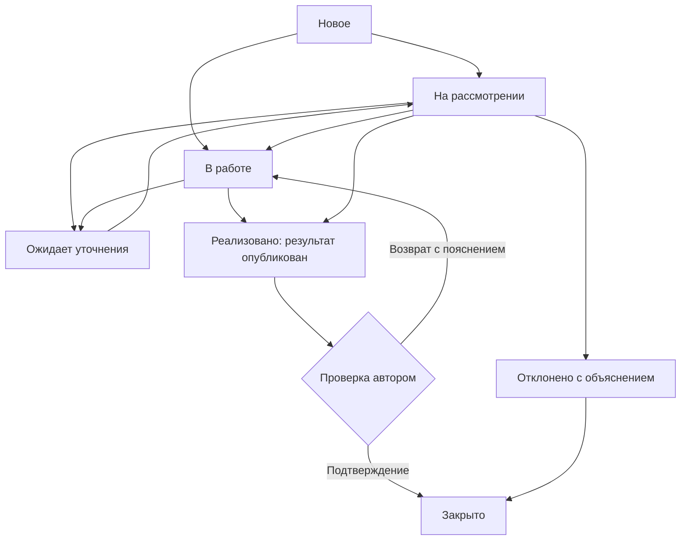
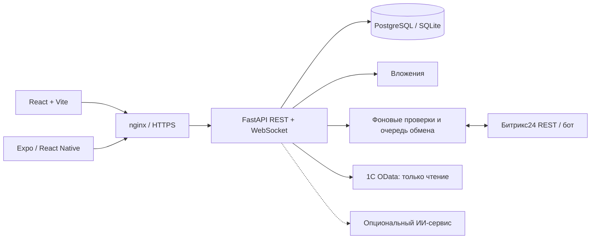

# Модус — от обращения сотрудника до подтверждённого улучшения

**Сайт · мобильное приложение · Битрикс24 · контекст из 1С**

[Открыть сайт](https://modus-trade.makquiz.site) · [Frontend](https://github.com/Modus-trade/modus-front) · [Backend](https://github.com/Modus-trade/modus-back) · [Мобильное приложение](https://github.com/Modus-trade/modus/blob/main/mobile/README.md)

Модус собирает проблемы, предложения и положительные отзывы сотрудников в один процесс: подача → назначение → обсуждение → решение → проверка автором. Руководитель видит ответственного, срок и историю; сотрудник понимает, что произошло с его обращением. Повторяющиеся проблемы получают общий счётчик участников, а подтверждённые решения можно превратить в инструкции для коллег.

Организация **Modus-trade** объединяет сервер, веб-клиент, мобильное приложение и документацию системы обратной связи сотрудников. Описание сверено с текущим кодом на **13 ноября 2026 года**. Скриншоты веб-версии сделаны в работающем локальном приложении; изображения мобильной версии и диалога Битрикс24 предоставлены командой. Это демонстрационные данные, а не отчёт о реальных результатах внедрения.

## Содержание

- [Быстро попробовать](#быстро-попробовать)
- [Роли и доступ](#роли-и-доступ)
- [Возможности сайта](#возможности-сайта)
- [Битрикс24](#битрикс24)
- [1С](#1с)
- [Мобильное приложение](#мобильное-приложение)
- [Жизненный цикл обращения](#жизненный-цикл-обращения)
- [Архитектура](#архитектура)
- [Репозитории и изменения](#репозитории-и-изменения)
- [Запуск и документация](#запуск-и-документация)
- [Ограничения и развитие](#ограничения-и-развитие)

## Быстро попробовать

Откройте [демонстрационный сайт](https://modus-trade.makquiz.site). Для демо-аккаунтов пароль — `demo1234`. Используйте разные профили браузера или обычное и приватное окно, чтобы одновременно посмотреть работу сотрудника и руководителя. Две вкладки одного профиля разделяют одну сессию.

| Роль | Учётная запись | С чего начать |
| --- | --- | --- |
| Сотрудник | `employee@modus.demo` | Создать обращение, открыть ответ, проверить результат |
| Руководитель закупок | `manager.procurement@modus.demo` | Открыть входящие, запросить уточнение, назначить срок |
| Администратор | `admin@modus.demo` | Центр внимания, настройки категорий, интеграции и эффект сервиса |

На чистой локальной установке эти аккаунты создаёт `seed.py`. Демо-пароль предназначен для демонстрации; для рабочей среды нужны собственные учётные записи.

## Роли и доступ

| Участник | Какие обращения доступны | Основные действия |
| --- | --- | --- |
| Сотрудник — автор | Собственные обращения | Подача, обсуждение, уточнение, проверка результата |
| Назначенный исполнитель | Назначенные ему обращения | Работает с обращением в рамках серверных прав; импортированный сотрудник Битрикса может быть исполнителем без роли администратора |
| Руководитель | Обращения авторов своего отдела и назначенные лично ему | Управление обработкой, аналитика доступных данных |
| Администратор | Все обращения | Управление пользователями, категориями, интеграциями, распределением |
| Присоединившийся к общей проблеме | Ограниченное представление общей проблемы | Видит стадию и результат; не получает приватное описание и переписку автора |

Приватность проверяется API при чтении карточек, комментариев, файлов и аналитики. Скрытая кнопка в интерфейсе не является механизмом защиты. Подача выполняется от авторизованного пользователя: **приватное обращение не равно анонимному**.

## Возможности сайта

### 1. Центр внимания администратора

Начальная страница администратора собирает обращения без ответственного, просроченный первый ответ, просроченное решение и сигналы отсутствия движения. Одно обращение может иметь несколько причин внимания, но в очереди показывается один раз. Фильтры и поиск помогают перейти от общей цифры прямо к проблеме.

Очередь выделяет приоритет и причины цветом и текстом. Строка содержит номер, тему, категорию, статус, исполнителя и последнее действие. Сначала рассматриваются обращения с несколькими причинами внимания, затем более высокий приоритет и давняя активность.

*Центр внимания: сводка и фильтры проблем. Скриншот от 13.11.2026; числа отражают состояние демонстрационной базы на момент съёмки.*

### 2. Подача обращения и помощь до отправки

Сотрудник заполняет тему и описание, выбирает тип и категорию, при необходимости прикладывает файлы и предполагаемое решение. Типы: проблема, предложение и положительный отзыв. Категория определяет исполнителя по умолчанию и срок первого ответа; если исполнитель не настроен, обращение требует распределения.

ИИ-подсказка предлагает тип и категорию по тексту и изображению. Пользователь может исправить выбор. При недоступности ИИ классификация использует правила. Форма также предлагает подходящие опубликованные инструкции: сотрудник может решить вопрос до создания новой заявки и отметить, помогла ли инструкция.

Вложения: PDF, PNG, JPG, DOCX, XLSX, TXT до 10 МиБ на файл. Привязка товара или заказа 1С необязательна. Автор сам решает, делать ли подходящую проблему общей; документ 1С требует приватного обращения.

*Форма обращения: описание, классификация и связь с 1С. Скриншот от 13.11.2026; числа отражают состояние демонстрационной базы на момент съёмки.*

### 3. Реестр обращений

Все обращения доступны через единый список с поиском, фильтрами и страницами. Для сотрудника это его рабочая область, для руководителя — доступные входящие, для администратора — общий реестр. Фильтры по статусу, типу и дополнительным параметрам помогают быстро найти конкретную работу.

Цвет обозначает состояние и срочность, но рядом остаётся текстовая подпись. По заголовку или стрелке открывается карточка, а номер позволяет найти то же обращение в уведомлении или интеграции.

*Реестр обращений и поиск. Скриншот от 13.11.2026; числа отражают состояние демонстрационной базы на момент съёмки.*

### 4. Карточка, обсуждение и история

Карточка объединяет описание, вложения, исполнителя, приоритет, стадии обработки, обсуждение и историю изменений. Ответственный может запросить уточнение, автор — ответить. Голосовые сообщения имеют плеер; при доступном ИИ к ним добавляется расшифровка.

Кнопка «Предложить решение» готовит вспомогательный разбор и черновик ответа. Он не отправляется автоматически. Изменения статуса, исполнителя, приоритета и результата остаются в истории.

*Карточка обращения A-003 с обсуждением и блоком задачи Битрикс24. Скриншот от 13.11.2026; числа отражают состояние демонстрационной базы на момент съёмки.*

### 5. Сроки и подтверждение результата

Срок первого ответа задаётся категорией. Срок решения назначается отдельно; перенос или снятие установленного срока требует причины. Фоновая проверка напоминает исполнителю о приближении срока решения и сообщает администраторам о просрочке.

«Реализовано» означает, что исполнитель опубликовал результат. Автор подтверждает его — обращение закрывается. Если проблема осталась, автор возвращает результат с пояснением, и работа продолжается. Подтверждается конкретная версия результата: замена текста требует новой проверки. Это позволяет считать проверенные улучшения, а не просто закрытые исполнителем задачи.

*Подтверждённые результаты и скорость реакции в отчёте эффекта. Скриншот от 13.11.2026; числа отражают состояние демонстрационной базы на момент съёмки.*

### 6. Уведомления внутри системы

Колокольчик показывает непрочитанные события: назначение, комментарий, уточнение, изменение статуса и результат. Нажатие ведёт в нужное обращение. Состояние прочтения хранится на сервере; живые события обновляют интерфейс через WebSocket после сохранения изменения.

При включённой интеграции связанный сотрудник также получает уведомление в Битрикс24. Доставка в портал выполняется отдельной очередью: временная ошибка портала не отменяет обращение в Модусе.

*Колокольчик: назначение и опубликованный результат. Скриншот от 13.11.2026; числа отражают состояние демонстрационной базы на момент съёмки.*

### 7. Инструкции и ответы

Подтверждённое решение можно обобщить в инструкцию: название, условия применения и шаги. Черновик редактируется отдельно от исходного обращения, проходит проверку и публикуется для отдела или компании. Публикация для всей компании требует администратора; для отдела — соответствующего руководителя или администратора.

Проверки отмечают распространённые секреты и персональные данные, но не заменяют редактора. Изменение опубликованной статьи создаёт новый черновик; есть версии, отзывы и жалобы на материал. Поиск инструкций и подсказки в форме подачи помогают уменьшать повторные обращения.

*Каталог инструкций; в снятой локальной базе публикации ещё не подготовлены. Скриншот от 13.11.2026; числа отражают состояние демонстрационной базы на момент съёмки.*

### 8. Общие и повторяющиеся проблемы

Автор может сделать проблему общей. Коллеги присоединяются через бота Битрикс24, вместо создания очередной копии. Счётчик «Столкнулись» включает автора и участников. Аналитика выделяет общие проблемы с несколькими участниками и сортирует их по числу пострадавших.

В текущей веб-форме автоматический поиск похожих общих проблем заменён подсказками инструкций. Общие проблемы и присоединение через бота сохраняются. Система не объединяет приватные обращения автоматически и не раскрывает их текст другим сотрудникам.

*Бот Битрикс24: диалог подготовки обращения и подтверждение отправки. Скриншот от 13.11.2026; числа отражают состояние демонстрационной базы на момент съёмки.*

### 9. Аналитика текущей работы

Обзор показывает количество обращений, долю закрытых, среднее время первого ответа, просрочки, распределение типов, статусов и категорий. Руководитель получает показатели только доступных ему обращений. Дополнительные блоки показывают повторяющиеся проблемы, результат помощи инструкциями и проблемы по объектам 1С.

«Решил вопрос по инструкции» — самоотчёт пользователя в рамках одной попытки, а не автоматически доказанная экономия времени. Создание обращения в той же попытке меняет её итог.

*Обзор: показатели, характер обращений и движение к результату. Скриншот от 13.11.2026; числа отражают состояние демонстрационной базы на момент съёмки.*

### 10. Эффект сервиса

Отдельная страница отвечает на вопрос, что меняется с течением времени. Доступны периоды 30, 60 и 90 дней и сравнение с предыдущим периодом такой же длины.

| Метрика | Как трактовать |
| --- | --- |
| Подано обращений | Созданные за период, а не весь накопленный реестр |
| Результатов подтверждено | Проверенные авторами результаты по дате подтверждения |
| Активные участники | Уникальные авторы новых обращений и комментариев за период |
| Медиана первого ответа | Время от создания до первого ответа для ответов в периоде |
| До подтверждения результата | Медиана времени от создания до подтверждения автором |
| Ответов в срок | Доля своевременных среди состоявшихся первых ответов |
| Незавершённая работа | Текущий остаток, включая реализованные, но ещё не подтверждённые обращения |

Также доступны недельная динамика за 12 недель, разрез по подразделениям и последние подтверждённые результаты со ссылками. При недостаточной истории показано предупреждение. Отсутствующее время обозначается отсутствием данных, а не нулевой длительностью.

Не смешивайте среднее время на общем обзоре с медианой в «Эффекте»: это разные расчёты. Страница показывает наблюдаемую динамику; данных до внедрения и расчёта денежного ROI в MVP нет.

*Эффект сервиса: сравнение периодов и полнота истории. Скриншот от 13.11.2026; числа отражают состояние демонстрационной базы на момент съёмки.*

### 11. Настройка процессов

Администратор управляет категориями, исполнителем по умолчанию и SLA первого ответа. Отдельно управляются пользователи, подразделения, роли и активность аккаунта. Деактивация сохраняет историю работы.

В карточке есть демонстрационные рекомендации исполнителей. Балл учитывает смоделированные опыт, успешность и загрузку с весами 50/30/20. Это **пример интерфейса, а не измерение эффективности людей и не вероятность успешного решения**. Назначение выбирает человек и сохраняет отдельно.

*Категории: маршрутизация и срок первого ответа. Скриншот от 13.11.2026; числа отражают состояние демонстрационной базы на момент съёмки.*

## Битрикс24

Битрикс24 — корпоративный портал с сотрудниками, структурой, задачами и мессенджером. Его роль в Модусе — доставлять работу и новости туда, где команда уже работает. При этом обращение, его история и подтверждение автора остаются в Модусе.

| Возможность | Действие на сайте | Получаемый результат |
| --- | --- | --- |
| Сотрудники и структура | Администратор запускает синхронизацию | Обновляются сотрудники, подразделения, руководители и состояние аккаунтов |
| Связь аккаунтов | Администратор сопоставляет импортированного человека с учётной записью | Назначение и уведомление адресуются одному и тому же человеку |
| Уведомления | Происходит рабочее событие | Очередь доставляет ссылку в портал, состояние видно в журнале |
| Задача | В карточке включают создание задачи и начинают работу | Создаётся одна связанная задача, появляются номер и ссылка |
| Обратный результат | Исполнитель закрепляет результат и завершает задачу | После опроса портала результат приходит в Модус на проверку автором |
| Бот | Сотрудник описывает проблему в личном чате | Бот уточняет категорию, предлагает похожие общие проблемы и просит подтвердить отправку |

Есть режимы `real`, `mock`, `off`. Реальный режим требует доступного портала и нужных REST-прав; доступность API зависит от условий портала. Мок позволяет проверить процесс без сети, но не доказывает соединение с настоящим Битриксом.

Импорт аккаунтов не является единым входом SSO. Иерархия руководителей создаёт основу для будущих сценариев эскалации, но не означает, что любая просрочка уже автоматически передаётся начальнику из `UF_HEAD`.

*Битрикс24 в Модусе: реальный режим, синхронизация и состояние обмена. Скриншот от 13.11.2026; числа отражают состояние демонстрационной базы на момент съёмки.*

### Как работает бот

1. Сотрудник должен быть импортирован и сопоставлен с активным аккаунтом Модуса.
2. В личном чате «Модус · Обращения» он описывает ситуацию; можно приложить до 5 файлов, каждый до 10 МиБ.
3. Бот предлагает тип и категорию. Пользователь подтверждает или меняет их.
4. Перед созданием показывается черновик. Команда «Отправить» создаёт обращение; «Отмена» удаляет черновик.
5. Для подходящей общей проблемы возможен отдельный сценарий присоединения с подтверждением.
6. В Модусе у обращения отображается источник «Битрикс24».

Используется опрос `imbot.v2`, поэтому для текущей реализации не нужен публичный callback с локального компьютера. Backend должен работать. Файлы загружаются с проверкой адреса; часть внешних ссылок и редиректов намеренно не поддерживается.

Подробные права, переменные окружения, повтор доставки и полный алгоритм проверки — в [инструкции Битрикс24](https://github.com/Modus-trade/modus/blob/main/backend/BITRIX24.md). Секрет вебхука хранится на сервере и не попадает в frontend.

## 1С

1С — семейство систем для учёта товаров, заказов, контрагентов и других бизнес-данных. В Модусе она даёт **контекст проблемы**: не просто «ошибка в каталоге», а конкретный товар или заказ.

| Функция | Работа в Модусе |
| --- | --- |
| Номенклатура | Поиск по названию, коду, артикулу и привязка позиции к обращению |
| Заказы | Поиск заказов поставщикам и клиентов; привязка нужного документа |
| Сохранение контекста | Снимок записи с `Ref_Key`, источником и временем привязки хранится вместе с обращением |
| Рейтинг проблем | Товары и поставщики сортируются по числу связанных проблем; строка открывает список обращений |
| Управление | Режим, проверка подключения, ручной импорт и журнал обменов |

Модус выполняет только чтение. Он не изменяет бухгалтерские документы, остатки и заказы в 1С. Поставщик в рейтинге определяется по заказу поставщику; контрагент заказа клиента не становится поставщиком автоматически.

*Панель 1С: демонстрационный каталог и ручное обновление. Скриншот от 13.11.2026; числа отражают состояние демонстрационной базы на момент съёмки.*

### Демо и реальная база

По умолчанию предусмотрены демонстрационные данные: 6 товаров, 2 заказа поставщикам и 1 заказ клиента. Привязки явно отмечены как демо. Реальная 1С заказчика пока не подключена: реализован и проверен на тестовом HTTP-транспорте адаптер OData.

Для подключения администратор 1С публикует доступные для чтения коллекции по HTTPS. На сервере Модуса задаются `ONEC_ODATA_URL`, `ONEC_USERNAME`, `ONEC_PASSWORD`. Имена сущностей и полей сверяются с `$metadata` конкретной конфигурации; они настраиваются через `ONEC_ENTITY_*` и `ONEC_FIELD_*`. Затем администратор выбирает «Реальная база», проверяет связь и обновляет каталог.

Поиск реальных документов сотрудниками по умолчанию закрыт. Его отдельное включение разрешает всем сотрудникам поиск опубликованного набора документов, поэтому публикация должна содержать допустимые данные. Привязанные к документу обращения приватные. При отключении интеграции старые снимки не исчезают; неудачный импорт сохраняет предыдущий каталог. Обновление сейчас ручное.

Настройка и проверка: [раздел backend](https://github.com/Modus-trade/modus/blob/main/backend/README.md#интеграция-1с).

## Мобильное приложение

Мобильный клиент использует тот же API, пользователей и серверные обращения, что и сайт. Можно подать обращение на месте, прикрепить фото, ответить в обсуждении и проверить статус. Интерфейс ориентирован на iOS, использует Expo/React Native, нативные элементы и эффекты iOS 26.

*Предоставленный командой обзор мобильного интерфейса. Полноразмерное изображение доступно по нажатию.*

| Экран | Что делает |
| --- | --- |
| Обзор | Показатели и обращения, требующие внимания |
| Входящие | Список доступных обращений, фильтры и переход в карточку |
| Новое обращение | Текст, тип, категория, фото/файлы, голосовое заполнение с проверкой человеком |
| Карточка | Обсуждение, голосовые сообщения, история и доступные действия исполнителя |
| Заметки | Личные заметки с локальными напоминаниями на устройстве |
| Профиль | Активность, настройки уведомлений и вибрации, выход |

Важное различие: заметки не синхронизируются на сервер. Системные уведомления формируются приложением по живым событиям и проверке изменений при открытии; полноценного серверного APNs/FCM push при закрытом приложении пока нет. Административные экраны интеграций и расширенная аналитика доступны в веб-версии.

Все предоставленные мобильные экраны с отдельными пояснениями, инструкции запуска и ограничения — в [mobile/README.md](https://github.com/Modus-trade/modus/blob/main/mobile/README.md).

## Жизненный цикл обращения

Диаграмма показывает основной пользовательский путь, а точные допустимые переходы задаются сервером. «Реализовано» и «Закрыто» различаются: первое ждёт проверки результата, второе завершает цикл. Отклонение также требует мотивированного результата. Нельзя считать все старые закрытые записи автоматически подтверждёнными авторами.

## Архитектура

| Слой | Реализация | Ответственность |
| --- | --- | --- |
| Веб | React 18, TypeScript, Vite, TanStack Query, Recharts | Сценарии пользователей, формы, диаграммы |
| Мобильный | Expo SDK 58, React Native, expo-router | Мобильные сценарии, запись голоса, локальные заметки |
| Сервер | Python, FastAPI, Pydantic, SQLAlchemy 2 | Права, переходы, данные, API |
| База | SQLite локально; PostgreSQL на сервере | Обращения, история, уведомления, настройки и очереди |
| Миграции | Alembic | Версионирование структуры базы |
| Сессии | JWT в httpOnly cookie | Единая авторизация клиентов; отдельный краткоживущий токен для мобильного WebSocket |
| Интеграции | Серверные адаптеры | REST Битрикса, OData 1С, повтор доставки |
| Поставка | GitHub Actions, systemd, nginx | Проверки, сборка, миграции и публикация |

ИИ — внешний опциональный сервис, а не встроенная гарантия правильного решения. Без него основной учёт продолжает работать; возможности распознавания голоса и генерации требуют его доступности. Подробнее: [ИИ-помощник](https://github.com/Modus-trade/modus/blob/main/docs/ai.md).

## Репозитории и изменения

| Репозиторий / каталог | Что здесь изменять |
| --- | --- |
| [modus-back](https://github.com/Modus-trade/modus-back) | Исходный backend, миграции, тесты API, интеграции |
| [modus-front](https://github.com/Modus-trade/modus-front) | Исходный веб-клиент, компоненты, стили, сборка |
| [modus](https://github.com/Modus-trade/modus) | Мобильное приложение, общая документация, Docker и объединённая поставка |
| `backend/`, `frontend/` в общем репозитории | Зеркала отдельных репозиториев, обновляемые CI |
| `mobile/` | Мобильный клиент; отдельного git-репозитория в этой рабочей структуре нет |

Правки backend/frontend вносите в соответствующий отдельный репозиторий: прямые изменения зеркал могут быть перезаписаны автоматической синхронизацией. У каждого репозитория собственные коммиты и push. `git pull` получает чужие изменения, `git push` отправляет ваши — это разные действия.

В отдельных репозиториях push в `main` запускает проверки, выкладку и синхронизацию в общий проект. Статус публикации проверяется во вкладке Actions. Успешный push сам по себе ещё не означает успешный деплой.

## Запуск и документация

Выберите руководство под свою задачу. Внутри — команды установки, переменные окружения, устройство кода и сценарии проверки.

| Руководство | Что найдёте |
| --- | --- |
| [Весь проект](https://github.com/Modus-trade/modus#readme) | Windows, macOS, Linux, Docker; роли, демонстрация и полный маршрут проверки |
| [Веб-клиент](https://github.com/Modus-trade/modus-front#readme) | Маршруты, компоненты, подключение API, тесты и production-сборка |
| [Сервер](https://github.com/Modus-trade/modus-back#readme) | FastAPI, миграции, права доступа, API, настройки интеграций и диагностика |
| [Мобильное приложение](https://github.com/Modus-trade/modus/blob/main/mobile/README.md) | Мобильные экраны, Expo, адрес API, голос, заметки и ограничения уведомлений |
| [Битрикс24: настройка](https://github.com/Modus-trade/modus-back/blob/main/BITRIX24.md) | Подключение портала, права, задачи, уведомления и чат-бот |
| [Сценарии проверки](https://github.com/Modus-trade/modus#проверка-функций) | Проверка полного пути обращения, интеграций и мобильного клиента |

## Ограничения и развитие

| Сейчас | Что потребуется для следующего этапа |
| --- | --- |
| 1С — демонстрационные данные и готовый адаптер | Публикация заказчика, проверка metadata и доступа, эксплуатационное тестирование |
| Рекомендации исполнителей — примерные метрики | Реальные согласованные данные и прозрачная методика; балл не должен подменять управленческое решение |
| Сравнение периодов внутри Модуса | Базовая линия до внедрения, регулярные контрольные точки и согласованная методика эффекта |
| Мобильные уведомления через активное приложение и проверку при открытии | Серверный push APNs/FCM и управление устройствами |
| Частные обращения с известным системе автором | Отдельная модель анонимности, если она согласована с заказчиком |
| Учёт проблем и предложений | Модуль опросов ещё не реализован |
| Импорт оргструктуры Битрикса | Полноценные правила эскалации по управленческой иерархии |
| Ручное обновление 1С | Расписание, мониторинг задержек и эксплуатационные регламенты |

Чтобы сервис продолжал использоваться, назначьте владельца процесса, регулярно разбирайте очередь просрочек и раз в месяц публикуйте подтверждённые результаты. На встрече по итогам периода смотрите одновременно скорость ответа, незавершённую работу, участие сотрудников и реальные примеры изменений. Одна красивая диаграмма без последующих действий не обеспечивает внедрение.

---

Сделано для ГК «Модус Трейд». Скриншоты показывают демонстрационные данные на 13.11.2026. [Источники изображений](https://github.com/Modus-trade/modus/blob/main/docs/images/README.md).
